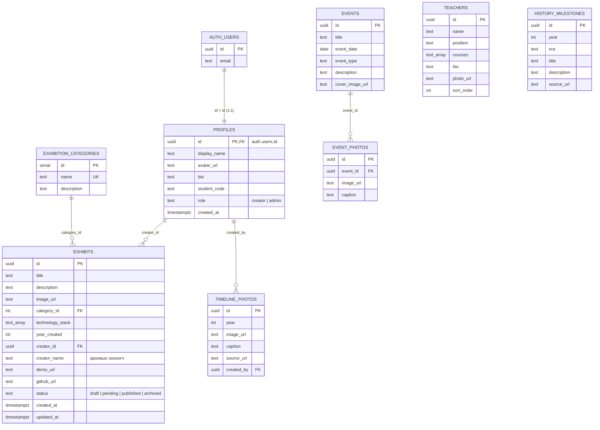

# Өгөгдлийн сангийн схем (ERD)

## Хүснэгт хоорондын холбоо

| Холбоо | Төрөл | FK | Устгах үеийн үйлдэл | Яагаад |
|---|---|---|---|---|
| `auth.users` → `profiles` | 1 : 1 | `profiles.id` | `on delete cascade` | Хэрэглэгч устгагдвал профайл нь хамт устна. Профайлыг `handle_new_user` триггер бүртгэлийн үед автоматаар үүсгэнэ. |
| `profiles` → `exhibits` | 1 : олон | `exhibits.creator_id` | `on delete set null` | Нэг оюутан олон бүтээлтэй (**ISM Creators** холбоос). Оюутны бүртгэл устсан ч бүтээл музейд үлдэнэ. |
| `exhibition_categories` → `exhibits` | 1 : олон | `exhibits.category_id` | `on delete set null` | Ангилал устгахад үзмэр устахгүй, зөвхөн ангилалгүй болно. |
| `profiles` → `timeline_photos` | 1 : олон | `timeline_photos.created_by` | `on delete set null` | Time Machine-д зураг оруулсан админ. Зураг он-оор (`year`) слайдтайгаа холбогдоно. |
| `events` → `event_photos` | 1 : олон | `event_photos.event_id` | `on delete cascade` | Зурагт цомог нь арга хэмжээнээсээ салж оршин тогтнохгүй. |

`teachers`, `history_milestones` нь бие даасан хүснэгт. `history_milestones`, `events`, `exhibits`-ийг **он**-оор нь нэгтгэж ISM Time Machine-ийг үүсгэнэ.

## Primary key-ийн сонголт

- **uuid** (`gen_random_uuid()`) — `exhibits`, `teachers`, `events`, `event_photos`, `history_milestones`. URL-д ил гарахад дараалал таагдахгүй, клиент талд ч үүсгэж болно.
- **serial** — `exhibition_categories`. Цөөн, админ удирддаг лавлах хүснэгт тул энгийн бүхэл тоо хангалттай.
- `profiles.id` нь Supabase Auth-ийн `auth.users.id`-тай яг ижил байх ёстой тул PK бөгөөд FK.

## Эрхийн хамгаалалт (RLS) — товч

| Хүснэгт | Зочин | Бүтээгч | Админ |
|---|---|---|---|
| profiles | унших | өөрийгөө засах (role-оос бусад) | бүгдийг засах |
| exhibits | `published`-ийг унших | өөрийн бүтээлийг нэмэх / засах / устгах, ноорогоо харах | бүгдийг |
| teachers, events, event_photos, history_milestones, timeline_photos, exhibition_categories | унших | унших | нэмэх / засах / устгах |
| storage `museum` | унших | зөвхөн `<өөрийн uid>/` хавтас руу бичих, устгах | бүгдийг устгах |

Нэмэлт хамгаалалт: `protect_profile_role` триггер энгийн хэрэглэгчийг өөрийгөө админ болгохоос, `exhibits_before_update` триггер үзмэрийн эзэмшигчийг бусдын нэр рүү шилжүүлэхээс сэргийлнэ.
